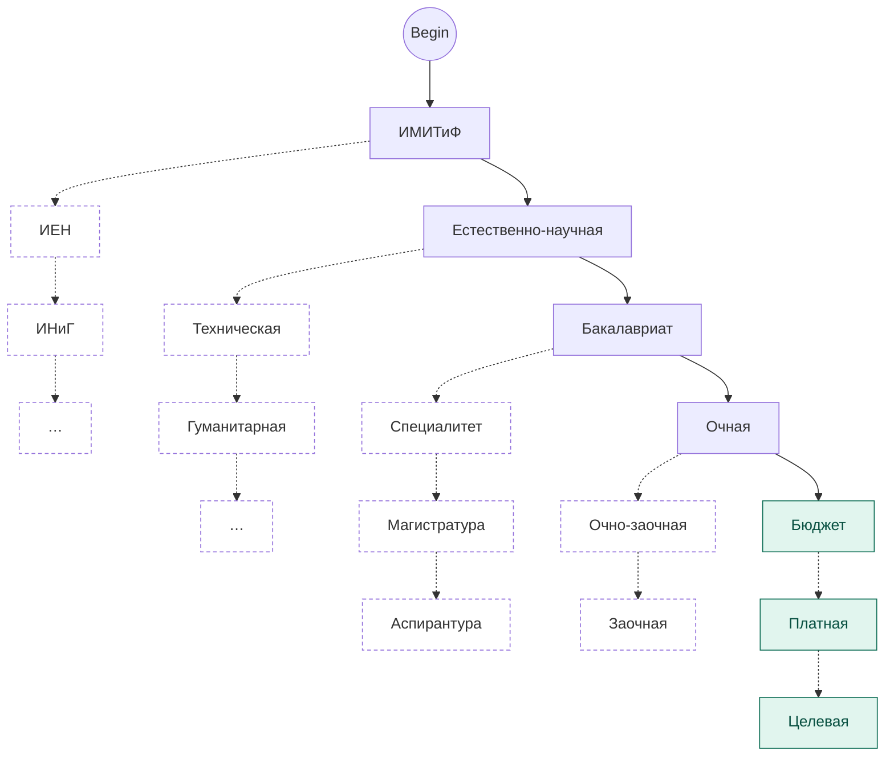

Это система распределения объектов по классам в соответствии с определенным признаком. Объект - информационный объект.
Требования к классификации:
Дз: выбрать предметную область. (пк,языки програм, авто)
1. Полнота охвата объектов рассматриваемоей области. 
2. Указание реквизитов - признаки классификации
3. Возможность добавления новых объектов
Существует 3 вида классификации:
4. Иерархический (Классификация живых существ) Преимущества: простота недостатки: структура - сложность изменения


## Фасетная система классификации
Позволяет выбирать признаки классификации независимо друг от друга. Эти признаки - фасеты. Содержат множество однородных значений. 
Пример: фасет(цвет) - зеленый, желтый, красный.
Дз: Сформировывается в виде таблицы. 5 столбцов. Строки от 1 до n (Остальное на фото)
Чертим дерево.

| №   | Ф₁ Институт | Ф₂ Область знаний       | Ф₃ Уровень   | Ф₄ Форма обучения | Ф₅ Основа |
| --- | ----------- | ----------------------- | ------------ | ----------------- | --------- |
| 1   | ИМИТиФ      | Естественно-научная     | Бакалавриат  | Очная             | Бюджет    |
| 2   | ИЕН         | Техническая             | Специалитет  | Очно-заочная      | Платная   |
| 3   | ИНиГ        | Гуманитарная            | Магистратура | Заочная           | Целевая   |
| 4   | ИЭиУ        | Социально-экономическая | Аспирантура  |                   |           |
| 5   | ИПСУБ       | Педагогическая          |              |                   |           |
| 6   | ИЯЛ         | Творческая              |              |                   |           |
| 7   | ИУФФиЖ      |                         |              |                   |           |
| 8   | ИППСТ       |                         |              |                   |           |
| 9   | ИИиС        |                         |              |                   |           |
| 10  | ИСК         |                         |              |                   |           |
| 11  | ИФКСиЗ      |                         |              |                   |           |
| 12  | ИИиД        |                         |              |                   |           |
| 13  | ИГЗ         |                         |              |                   |           |
## Недостатки доделать!



  

Пунктирная рамка у узла — у него есть свой левый потомок (поддерево следующего фасета), здесь он свёрнут.


Пример: 
Предметка: студент удгу
Таблица(фасеты) схожа на анкетирование
В столбце не должно быть повторений

### Преимущества:
1. Возможность создания классификаций большой емкости за счет использования большого числа признаков
2. Простота внесения изменений
### Недостатки
1. Сложность построения тк необходимо перечислить все возможные сочетания признаков

## Дескрипторная система
Используют ключевые слова или словосочетания которые описывают предметку
Пример: успеваемость студента
1. студент
2. дисциплина
3. препод
4. экзамен
5. оценка
6. аудитория
7. расписание
8. посещаемость
   В процессе построения классификации могут появится синонимы. В этом случае оставляют один.
   ДЗ: Нужно составить словарь терминов. Можно взять фасеты и написать определение. Шо эт (тогда будет чисто текст - словарь).

Увязка теоремы с ограничениями пропускной способности квантовых каналов.

Предположим что сообщение источник информации формируется из знаков внешнего алфавита объемом. Таким образом сообщение представляют слова в виде последовательности 
$$
nr 
$$
знаков.
$$
a_{i}, i=1,2,3\dots N_{a}
$$
В кодирующем устройстве оно преобразуется в кодовое слово 
$$
B_{r} = b_{1,b_{2}\dots, b_{nr}}
$$
составленного из bj где j - внутреннего алфавита

$$
b_{j}, j = 1,2,3,4\dots N_{b}
$$
Число знаков внутреннего алфавита называют основанем.
Отображение множества слов называют кодом
$$
G: A\to B
$$
Код - правило отображения знаков одного алфавита в знаки другого алфавите. Различают:
1. Побуквенное кодирование. Каждой букве ставят соответствие 1 другую
2. Блочное кодирование.
Слова из знаков B полученное из знаков A по правилу G, назыв. Кодывми комбинациями
Обратный прцесс кодирования - декодирования
$$
G^-1
$$
Код называется обратимым если существует единственное преобразование. Происходит восстановление закодитрованного слова.
Критерии:
Разные символы A должны быть поставлены разные кодовые комбинации
Никакая комбинация не должна составлять начальной части
### Теорема Котельникова (Найквиста-Шеннона)

**Формулировка.** Если сигнал x(t) имеет спектр, ограниченный полосой [−F, F], то он однозначно восстанавливается по отсчётам, взятым с шагом T ≤ 1/(2F):

```
x(t) = Σ x(nT) · sinc((t − nT)/T),   sinc(u) = sin(πu)/(πu)
```

Частота дискретизации должна быть не меньше **2F**.

### Почему это работает

1. Дискретизация равна умножению сигнала на гребёнку δ-импульсов с периодом T.
2. Умножение во времени даёт свёртку в частоте, поэтому спектр **периодически копируется** с шагом 1/T.
3. Если 1/T ≥ 2F, копии не перекрываются, и идеальный ФНЧ с полосой F вырезает исходный спектр. Во времени ФНЧ даёт интерполяцию функциями sinc.
4. Если 1/T < 2F, копии налезают друг на друга и возникает **алиасинг**: высокие частоты необратимо маскируются под низкие.
Теорема Котельникова отвечает на вопрос: **сколько независимой информации помещается в сигнал с ограниченной полосой.** В квантовой связи она нужна в двух местах.

**1. Сколько «ячеек» для фотонов даёт канал**

Световой сигнал с полосой W за время T можно разбить на примерно W·T независимых временных слотов (мод). Это тот же счёт отсчётов, что в теореме. В каждый слот можно положить фотон или его отсутствие, или закодировать значение в фазе и амплитуде. Поэтому максимальная скорость квантового канала считается так: число слотов в секунду × информация на один слот. Без теоремы нельзя сказать, сколько слотов в секунду у тебя вообще есть.

**2. Оцифровка сигнала в CV-QKD (самое практичное применение)**


В квантовой связи на непрерывных переменных информация сидит в амплитуде и фазе света. Приёмник превращает её в обычное электрическое напряжение, и это напряжение оцифровывает АЦП. Здесь теорема работает буквально:

- АЦП должен дискретизировать минимум вдвое быстрее полосы детектора. Иначе происходит алиасинг: высокочастотный шум маскируется под полезный сигнал.
- В квантовой криптографии это критично: лишний шум в данных выглядит как «подслушивание» или занижает оценку безопасности, и скорость секретного ключа падает.
- Форму импульсов подбирают по критерию Найквиста, чтобы соседние символы не наползали друг на друга.
### Оптимальное кодирование
Любое сообщение можно закодировать различными способами 
Оптимальным будет код который будет иметь минимальную длинну, то время его передачи будет минимальным
### Помехи и их классификация
Это накладывается на полезный сигнал и затрудняющие его прием
1. Источчники:
- внешние
	- атмосферные
	- идустриальные
	- перекрёстные
	- организованные
- внутренние
1. Помехи
- регулярные
- случайные
	- Импульсные
	- Флуктуционные 

Внешние источники помех вызывают в основном импульсные помехи